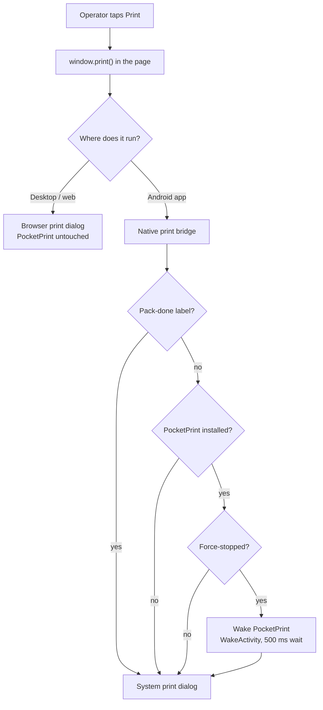

# Waking PocketPrint from a printing app

Some Android ROMs force-stop PocketPrint on their own. A zltd N7L did it with the
Darkstore app in front. While the package is stopped, that ROM never binds its print
service, and the print dialog says **"This printer isn't available right now"** until
somebody opens PocketPrint by hand.

Nothing inside PocketPrint can undo a force-stop: its jobs, alarms and receivers are all
off until one of its components is started by name. So the way out belongs to the app that
is about to print. It starts `WakeActivity`, waits a moment, and then opens the print
dialog.

## What `WakeActivity` is

An exported activity with no intent filter, so it is reachable by its exact name only. It
draws nothing and finishes in `onCreate`: `Theme.NoDisplay`, excluded from recents, no
history, empty task affinity. Starting it clears the stopped state; the print dialog's bind
then connects as on any other day.

It reads nothing from the intent. It also deliberately skips `PrintServiceRebind`, which
disables the print service for twenty seconds and would empty the dialog being opened. The
stop canary is left alone too, so the next time a person opens PocketPrint it still knows a
stop happened and can repair a binding the stop left dead (see "Turning the print service
on" in the [README](../README.md)).

Component: `com.gulshan.pocketprint` / `com.gulshan.pocketprint.WakeActivity`

## What the calling app does

The Android app's native print bridge decides, per print, whether to wake PocketPrint.
The page calls `window.print()`; on desktop the browser's own dialog
opens and PocketPrint is not involved.



- **Pack-done label:** printed straight away, no wake.
- **PocketPrint not installed:** nothing to wake, the dialog opens.
- **Not force-stopped:** nothing to wake, the dialog opens.
- **Force-stopped:** start `WakeActivity`, wait 500 ms, then open the dialog.

## Testing

### Automated

`WakeActivityTest` reads the merged manifest and pins:

- the published class name is the class's real name;
- it is exported and has no intent filter;
- it never shows: `NoDisplay` theme, excluded from recents, `noHistory`, empty affinity;
- it starts no rebind.

```bash
./gradlew :app:testDebugUnitTest --tests '*WakeActivityTest' --rerun
```

`--rerun` matters: Gradle does not track the manifest as a test input, so an edit to it
alone will not re-run the test. With a lost theme planted in the manifest the test went
red, and green once restored.

### On a device

Checked on a zltd N7L (Android 9) with a 3R20P-6E1A, with no labels spent.

| Steps | Result |
|---|---|
| Force-stop PocketPrint, open Darkstore's print dialog | "Isn't available" (the fault) |
| Force-stop, start `WakeActivity`, open the dialog | Printer listed at once |
| Force-stop, open the dialog, then start `WakeActivity` | Printer listed within 5 s |

`WakeActivity` stayed out of recents and Darkstore stayed in front throughout.

To repeat the wake by hand, without the calling app:

```bash
adb shell am force-stop com.gulshan.pocketprint
adb shell am start -n com.gulshan.pocketprint/.WakeActivity
```

### End to end, from the WMS app

Run each row on the N7L. Open the Darkstore print page, tap Print, and note which dialog
you get and whether the printer is listed.

| # | Setup | Expect |
|---|---|---|
| 1 | Desktop browser | Browser print dialog; PocketPrint not started |
| 2 | Android app, PocketPrint running | System print dialog, printer listed, no 500 ms wait |
| 3 | Android app, PocketPrint force-stopped | Printer listed in the dialog without opening PocketPrint |
| 4 | Android app, PocketPrint force-stopped, pack-done label | Dialog opens at once, no wake |
| 5 | Android app, PocketPrint uninstalled | System print dialog opens, no error from the bridge |

For each, also check that Darkstore stays in front and PocketPrint does not appear in
recents.

Rows 1 to 5 describe the intended behaviour of the WMS-side change. Record the date and
device of each run below.

| Run | Date | Device | Rows passed |
|---|---|---|---|
| | | | |
